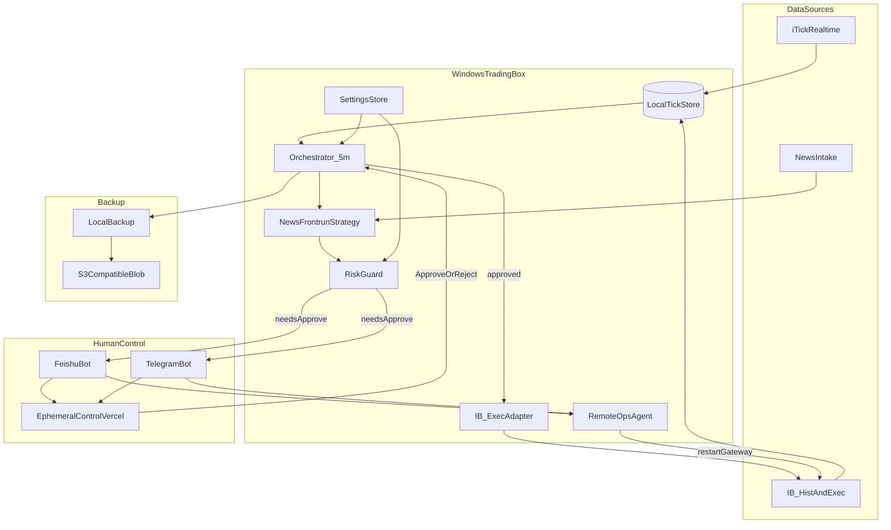

# 02 — Architecture

## Summary

Athena is a **greenfield monorepo**. Runtime target is a **Windows trading box**; development is on **Mac**. Control plane (bots + ephemeral web) can reach the box securely; trading data plane stays local.

## High-level diagram



## Planes

| Plane | Responsibility | Where it runs |
|-------|----------------|---------------|
| **Data** | iTick ticks/bars, IB hist + chains on schedule, news events | Windows box |
| **Decision** | Tags, NFR phase, tactic selection, draft actions | Windows box |
| **Risk / Settings** | Limits, privilege, params | Windows box (SoR) |
| **Execution** | IB orders only after approve (or auto if privilege allows) | Windows box + IB Gateway |
| **Control** | Feishu / Telegram / ephemeral web | Bots on box or sidecar; control-web on Vercel |
| **Ops** | Health, restart Gateway/services, backup | Windows box |
| **Backup** | Local snapshots → S3-compatible | Windows box → blob |

## Monorepo layout (target)

```
zeptun-ai-v4/
  docs/
    athena/                 # this proposal set
    automation/             # existing WorkBuddy-style runbooks
  apps/
    orchestrator/           # Python: 5-minute main loop + state machine
    exec-ib/                # IB adapter, slot manager, reconnect
    bots/                   # Feishu + Telegram command/notify
    control-web/            # Vercel: one-time approve/select UI
    ops-agent/              # restart services, health endpoints
  packages/
    strategy-nfr/           # News Front-Running phases + tactic rules
    settings/               # schema, validation, versioning
    risk/                   # pre-trade / post-trade guards
    marketdata/             # iTick + IB hist clients
    store/                  # DB schema, migrations, repositories
    notify/                 # shared message types / card payloads
  deploy/
    windows/                # services, scripts, optional compose
  .env.example
  README.md
```

### Language split

| Area | Language | Why |
|------|----------|-----|
| Orchestrator, IB, strategy, store | Python 3.12+ | IB ecosystem, DSH harness, fanbao/nanobot patterns |
| control-web | TypeScript (Next.js on Vercel) | Ephemeral UI, auth tokens |
| Bots | Python (reuse nanobot-style channels) or thin TS | Prefer one bot runtime on the box |

Nautilus Trader is **out of MVP**; revisit after HITL + slots are stable.

## Core processes on Windows

1. **IB Gateway** (or TWS) — single live API session; Athena uses a dedicated `client_id` during Athena slots.
2. **Athena Orchestrator** — APScheduler / asyncio loop (~5 min); paper or live mode.
3. **Marketdata writers** — iTick poll/stream → store; IB hist jobs in IB slots.
4. **Bots** — Feishu + Telegram long-poll/WS.
5. **Ops agent** — local HTTP or named-pipe commands from bots (restart Gateway, restart orchestrator, status).
6. **Postgres/Timescale** (+ optional Redis for approve tokens / queues).

## Orchestrator state machine

Aligned with the original PRD loop, adapted for HITL:

`INIT → IDLE → SCAN → DECIDE → AWAIT_APPROVE → EXEC → WAIT → IDLE`

- At default privilege, `DECIDE` emits **draft actions**, not orders.
- `AWAIT_APPROVE` is async: loop continues scanning; drafts expire per Settings.
- `EXEC` only after Approve (or auto if privilege allows and risk passes).

## Settings as a first-class package

All parametric behavior loads from `packages/settings` (DB-backed, versioned). Env vars are for secrets and bootstrap only (API keys, DB URL), not strategy knobs.

See [04-settings-and-risk.md](04-settings-and-risk.md).

## Dev (Mac) vs Run (Windows)

| Concern | Mac | Windows |
|---------|-----|---------|
| Edit / test unit | Yes | Optional |
| IB Gateway live | Optional paper | Primary |
| Bots pointing at engine | Point to Windows over VPN/Tailscale/SSH tunnel | Local |
| control-web | Deploy Vercel; callbacks to Windows webhook | Receives signed approve callbacks |
| Docker | Fine for DB/redis in dev | Prefer native services if Gateway needs host networking |

Recommended remote access: Tailscale (or similar) so Vercel/bots call a private webhook without exposing IB ports publicly.

## Data stores (logical)

| Store | Contents |
|-------|----------|
| `market_bars` | `ib-daily` and `ib-delayed`. One merged day is the indicator window. `itick` is not part of that window |
| `option_choices` / `option_plans` | Asks the strike menu ranks. Liquidity and vendor IV columns stay empty until the broker sends them |
| `chain_marks` | At-the-money mids appended on a live slot. Not read yet |
| `rv_marks` | Daily `RV20`, method `close_log_252` |
| `iv_marks` | Old premium-ratio rows, tagged with `method`. No implied vol is written |
| `symbol_phases` | Phase, tags, and `indicators` numbers |
| `decision_trails` / `ai_calls` | What the pass decided, and each model reply |
| `drafts` | Proposed actions. Pending until Approve |
| `orders` / `fills` | Execution audit |
| `positions` | Snapshots from IB sync |
| `settings_versions` | Audited config |
| `approvals` | Who approved what |
| `news_events` | Structured news |

## Integration with fanit

- **Do not** embed Athena inside income-tracker.
- Optional later: `packages/fanit-export` push fills/positions via CLI or shared SQLite/API.
- Until then, you may still update fanit manually after Athena fills.

## Security baseline

- Allowlist Feishu/Telegram user IDs
- Ephemeral control links: single-use, short TTL, signed tokens
- No public IB Gateway ports
- Secrets in env / OS credential store, not in git
- Privilege elevation requires stronger confirm (see human-control doc)
