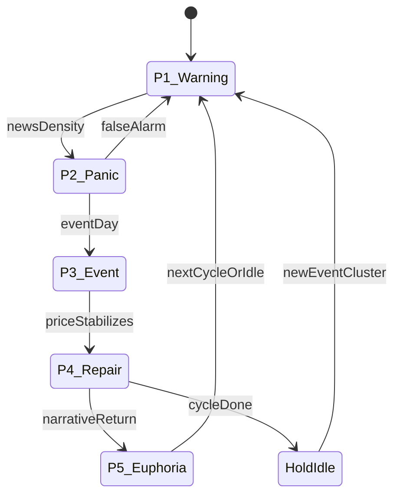

# 03 — Strategy: News Front-Running Cycle

## One strategy

Athena runs **exactly one** strategy product: the **News Front-Running Cycle (NFR)**.

CSP, CC, Strangle, Hold, Roll, and Close are **tactics**. Phases P1–P5 stay as news-cycle context. They do not pick an open. Location and News write one tag set. CSP, Strangle, Purchase, and Call each read it. The consolidator, with thinking on, chooses the drafts. Income or Accumulate, and Long, are per symbol on Universe. Nothing is sent until Approve.

Refine this cycle for 5–10 years. Improvisation = Settings versions + rule comments, not new strategy packages.

## Thesis (plain language)

Around known macro/event windows (Fed, major regulation, earnings clusters), markets often see:

1. Early negative narrative / “wash” pressure  
2. Realized volatility rising with the selloff  
3. Event print  
4. Repair after the event  
5. Narrative return / chase  

Athena’s job: **detect phase**, show a short strike menu with numbers, draft size within risk, and wait for your Approve (default). A phase label does not by itself create a draft.

## Phase machine

| Phase | Window (typical) | Detection (inputs) | Typical intent |
|-------|------------------|--------------------|----------------|
| **P1 Warning** | T−7 … T−3 | Rising negative news density; calendar event approaching | Watchlist; Hold |
| **P2 Panic** | T−3 … T−1 | Price weak, volume spike, NEWS_WASH active | Consider **Strangle** |
| **P3 Event** | T day | Calendar match / official release | Hold; no new aggression |
| **P4 Repair** | T+1 … T+3 | Price stabilizes after the event | Close or reduce; CSP or CC by location |
| **P5 Euphoria** | T+5 … T+10 | Price into the top of the channel | Prefer **CC** only when the shares cover it |

Windows are **Settings parameters**, not hard-coded forever.

## Price

Rails, RSI, realized volatility, and the indicator tags read **one bar per calendar day**.

- Sources in that window are `ib-daily` and `ib-delayed` only. `seed` and `pool-sync` are gone. An `itick` print, if one is stored, is not a daily bar.
- A later `ib-delayed` print on the same day updates that day’s **close**. The high and the low stay on the `ib-daily` bar.
- `last_tradeable_price` is the newest delayed print, otherwise the daily close. It is the draft reference price. It is not an input to a rail or a volatility rank.
- A name with fewer than 252 `ib-daily` sessions is `history_short`. Its range tags are `HIGH_RANGE` and `LOW_RANGE`. The 52-week label is used only after 252 sessions exist.

## Tags (drivers, not strategies)

Tags are a registry. An unknown tag is logged and kept on the audit row. Indicator numbers are stored on `symbol_phases.indicators` and shown beside the tags. The model sees the numbers. It does not see an implied-vol figure.

| Tag or number | Meaning |
|---------------|---------|
| `RV_HIGH` / `RV_LOW` | `RV20` at or above the 80th percentile of its own history, or at or below the 20th. Needs 20 samples of method `close_log_252`. This is the volatility gate. |
| `RV20` | 20-day close log-return, annualized. A level, not a rank. |
| `rail_pos` | Where the last close sits in the 63-session high–low channel, from 0 to 1. |
| `TREND_STRONG` / `TREND_WEAK` | Both channel edges slope the same way versus 21 sessions ago, past the slope minimum. |
| `DRAWDOWN_OK`, `drawdown_pct` | Close is between 5% and 15% under the 63-session high. |
| `DIP_BOUGHT` | The channel was at or below 0.35 inside the last 5 sessions, has reclaimed 0.45, and the trend is strong. |
| `RECLAIM` | Close is above the recent average, or above the prior bar’s high. |
| `VOLUME_DRY` / `VOLUME_SPIKE` | Latest volume versus the prior 20 sessions. |
| `ATR`, `ATR_WIDE` | 14-session average true range. Wide means ATR is at least 4% of price. |
| `EARNINGS_NEAR` | Inside the earnings blackout. |
| `NEWS_WASH` | Elevated negative news density. |
| `REGIME_RISK_OFF` | `SPY` close is under its own 63-session midpoint. No `SPY` bars records `regime_unknown` and does not stop the name. |
| `HIGH_RANGE` / `LOW_RANGE` | Range tags when history is shorter than 252 sessions. |

`HIGH_IV` and `LOW_IV` stay as aliases so old rows can still be grouped. They are not produced, and they are not a reason to open. `estimated_iv()` returns nothing. There is no `IV_RICH` or `IV_CHEAP`.

Each live Athena slot appends one at-the-money call mid and put mid to `chain_marks`. Nothing reads that table yet. A replay does not write it.

## Strike menu

Code ranks the chain. The model sees at most three puts and three calls, each with DTE, distance, delta, annualized yield, and breakeven. A missing number is written `unknown`. The model may name a row in that list. A strike that is not in the list is skipped.

- Discovery uses `chain_band_pct` (default 25). That is the width fetched around the price, up to eight strikes on each side. It is not a cut that throws away everything inside 10%.
- Selection uses a delta target. Cash-secured put target 0.25, band 0.10–0.40. Covered call target 0.30, and the strike must be at least the share cost (`avg_price`). Strangle target 0.28.
- Delta is Black–Scholes with interest rate 0. The volatility input is `RV20` times a multiple: 1.05 when `RV20` is at least 45%, 1.35 from 25% up to 45%, 1.80 below 25%. That multiple is an assumption used to pick a strike. It is not implied volatility, and it does not create a rich or cheap tag.
- The distance target is half of that volatility times the square root of DTE over 365, then clamped between 3% and 20%. A clamp is written on the audit row.
- Annualized yield is ask divided by strike, times 365 over DTE. A covered call also shows yield on the share cost when a cost exists.
- Each expiry inside the DTE band can carry asks. The menu walks expiries by distance from the target DTE.
- Bid, open interest, volume, and a vendor IV column exist on `option_choices` and stay empty until the broker sends them. Liquidity on the menu is `unknown`.
- `ATHENA_SCREENER=off` restores the old free-text lines.

## Tactic selection (inside NFR)

| Situation | Tactic | Notes |
|-----------|--------|-------|
| Listed strangle rows, and no option already open | OPEN_STRANGLE | Both legs come from the menu |
| Listed put, cash reserve holds | OPEN_CSP | One short put per name |
| Listed call, and the shares cover it | OPEN_CC | Strike at least the share cost. See the cover rule below |
| No listed edge | HOLD | Default |
| DTE at or under `roll_dte`, or `profit_take_pct` captured | ROLL or CLOSE | Position management. Still pending until Approve |

### Cover and conflict

These run before a draft can be pending. They use the same account and the same simulated book as the draft.

- A covered call is blocked unless the contracts fit in `floor(shares / 100)` after short calls already held or submitted. The reason names the shares required and the shares held. One share cannot cover a call.
- A second short put on the same name is blocked.
- A strangle is blocked when that name already has an option leg.
- A short put and a covered call may both exist. That is the wheel. `strict_conflict` on restores the old rule that any short blocks every new open. Default is off.
- After each leg is legal, the ticket is checked as one cash need: share buys at their limits, plus each short put’s strike times the multiplier. If that need breaks `cash_reserve_pct`, every leg on the ticket is blocked. Missing cash or NAV marks skip that check. They are not invented. New short margin uses `margin_rate` (default 20%).

## Position management (automated drafts)

Even with Approve-all, Athena **drafts** management actions on the 5-minute loop:

- DTE below threshold → propose roll/close  
- ≥ X% of max profit → propose take-profit close  
- Breach of risk / phase invalidation → propose flatten  
- Assignment / unexpected fill (Mobile ad-hoc) → reconcile + alert  

You Approve each draft at default privilege.

## Universe / watchlist

- Start small: names you are willing to own (align with fanit wheel “must-hold” discipline).
- NFR can temporarily elevate a name onto the watchlist when news density spikes; graduation to trade still needs liquidity + IV + Approve.
- Avoid US ADR delisting-risk names for CSP unless Settings override (learn from income-wheel rules).

## Parameterization (owned by Settings)

Examples (full list in [04-settings-and-risk.md](04-settings-and-risk.md)):

- Phase window days relative to event T  
- News density thresholds for NEWS_WASH  
- `RV20` window and the high / low percentiles  
- Chain band, delta targets, and the 3%–20% distance clamp  
- The three RV multiples, labeled as an assumption  
- DTE band, profit-take %, roll DTE  
- Max contracts per name, cash reserve for a short put  

## Improvisation workflow

1. Comment on a draft via bot (“widen put strike”, “skip this Fed”)  
2. Or open control link → amend fields → Approve  
3. Or change Settings version (strategy params) with audit note  
4. Athena does **not** require a new strategy package for tweaks  

## What we deliberately do not build

- Parallel “CSP strategy product” vs “CC strategy product” codebases  
- Auto-trading every MAG7 headline without phase + Approve  
- Weeklies-only scalping as core (optional later param, not MVP focus)  
