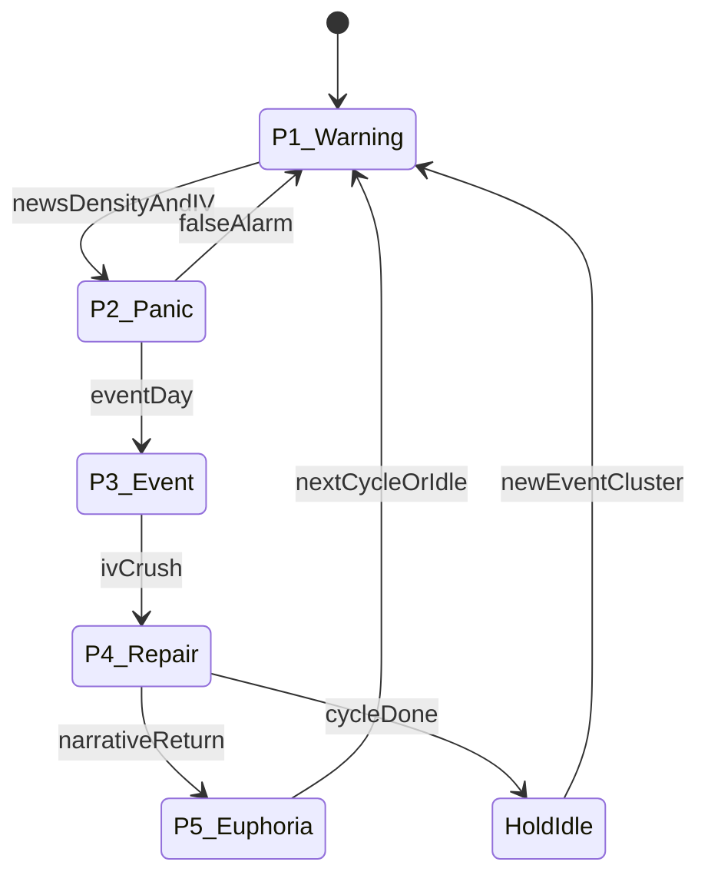

# 03 — Strategy: News Front-Running Cycle

## One strategy

Athena runs **exactly one** strategy product: the **News Front-Running Cycle (NFR)**.

CSP, CC, Strangle, Hold, Roll, and Close are **tactics** selected by phase + tags + Settings — not separate strategy engines to maintain forever.

Refine this cycle for 5–10 years. Improvisation = Settings versions + rule comments, not new strategy packages.

## Thesis (plain language)

Around known macro/event windows (Fed, major regulation, earnings clusters), markets often see:

1. Early negative narrative / “wash” pressure  
2. IV expansion + panic selling  
3. Event print  
4. IV crush + repair  
5. Narrative return / chase  

Athena’s job: **detect phase**, pick the **right tactic**, draft size/strikes within risk, and wait for your Approve (default).

## Phase machine

| Phase | Window (typical) | Detection (inputs) | Primary tactic |
|-------|------------------|--------------------|----------------|
| **P1 Warning** | T−7 … T−3 | Rising negative news density; calendar event approaching | Watchlist + monitor IV; Hold |
| **P2 Panic** | T−3 … T−1 | Price weak, IVR high, volume spike, NEWS_WASH active | Consider **Strangle** (sell vol) |
| **P3 Event** | T day | Calendar match / official release | Hold strangle; no new aggression |
| **P4 Repair** | T+1 … T+3 | IV crush confirmed; price stabilizes | Close/reduce strangle; shift to CSP or CC by location |
| **P5 Euphoria** | T+5 … T+10 | Price into resistance, IV low/mid | Prefer **CC** if long stock; else Hold |

Windows are **Settings parameters**, not hard-coded forever.

## Tags (drivers, not strategies)

Reuse the PRD tag idea; tags feed the phase + tactic chooser.

| Tag | Meaning (summary) |
|-----|-------------------|
| HIGH_IV / LOW_IV | IV rank thresholds (Settings) |
| EARNINGS_NEAR | Within N days of earnings |
| FED_EVENT | Within Fed/macro window |
| SUPPORT_TOUCH / RESISTANCE_TOUCH | Price vs local levels |
| OVERBOUGHT / OVERSOLD | RSI-style extremes |
| NEWS_WASH | Elevated negative/adversarial news density |
| MAG7 / HIGH_BETA / AI_NARRATIVE | Universe classifiers |
| STRONG_FCF / WEAK_MARGIN | Fundamental resilience hints |

Lifecycle: `PENDING → ACTIVE → EXPIRED` (timeouts in Settings).

## Tactic selection (inside NFR)

| Situation | Tactic | Notes |
|-----------|--------|-------|
| P2 + HIGH_IV + NEWS_WASH | OPEN_STRANGLE | Core NFR harvest |
| P4 + IV crush | CLOSE / reduce strangle | Lock vol crush |
| P4/P5 + OVERSOLD + support | OPEN_CSP | Only if cash-secured per Settings |
| P5 + OVERBOUGHT + long shares | OPEN_CC | Prefer must-hold names |
| Low IV, no edge | HOLD | Default |
| DTE short / 50% profit | ROLL or CLOSE | Position management |

Conflict rule (Settings-enforced): do not hold conflicting directional short options on the same underlying unless explicitly allowed (e.g. defined strangle).

## Position management (automated drafts)

Even with Approve-all, Athena **drafts** management actions on the 5-minute loop:

- DTE below threshold → propose roll/close  
- ≥ X% of max profit → propose take-profit close  
- Breach of risk / phase invalidation → propose flatten  
- Assignment / unexpected fill (Mobile ad-hoc) → reconcile + alert  

You Approve each draft at default privilege.

## Universe / watchlist

- Start small: names you are willing to own (align with fanit wheel “must-hold” discipline).
- NFR can temporarily elevate a name onto the watchlist when news density spikes; graduation to trade still needs liquidity + IV + Approve.
- Avoid US ADR delisting-risk names for CSP unless Settings override (learn from income-wheel rules).

## Parameterization (owned by Settings)

Examples (full list in [04-settings-and-risk.md](04-settings-and-risk.md)):

- Phase window days relative to event T  
- News density thresholds for NEWS_WASH  
- IVR cutovers for HIGH_IV / strangle eligibility  
- Strike buffers (% OTM), DTE bands, profit-take %  
- Max contracts per name, cash reserve for CSP  

## Improvisation workflow

1. Comment on a draft via bot (“widen put strike”, “skip this Fed”)  
2. Or open control link → amend fields → Approve  
3. Or change Settings version (strategy params) with audit note  
4. Athena does **not** require a new strategy package for tweaks  

## What we deliberately do not build

- Parallel “CSP strategy product” vs “CC strategy product” codebases  
- Auto-trading every MAG7 headline without phase + Approve  
- Weeklies-only scalping as core (optional later param, not MVP focus)  
