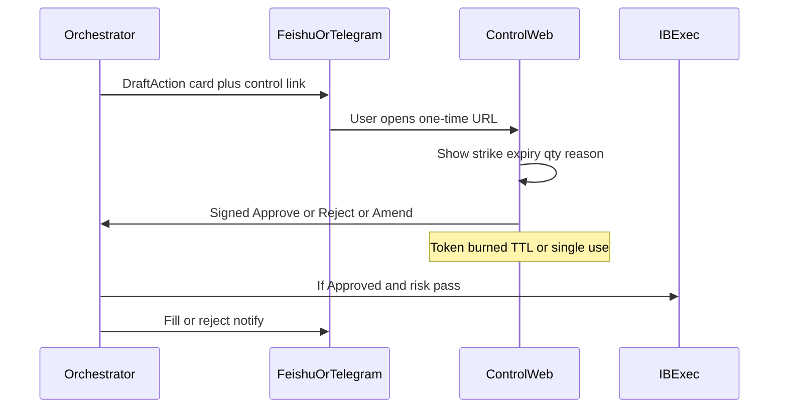

# 05 — Human Control (Feishu, Telegram, Ephemeral Web)

## Purpose

Control Athena when you are not at the Windows box: review drafts, Approve/Reject, tweak selections, change Settings, and trigger ops (restart Gateway). Messaging is the **remote cockpit**; ephemeral web pages are for **richer one-time decisions**.

## Channels

| Channel | Role | MVP status |
|---------|------|------------|
| **Feishu bot** | Primary work chat (cards, approve buttons, ops) | Stub until app credentials |
| **Telegram bot** | Travel / backup channel; same command surface | Stub OK; **connection page must include connect guide** (below) |
| **Ephemeral control-web** | One-time links for multi-field approve/amend; expires after use or TTL | Includes `/connect/telegram` guide page |
| **Local logs / later UI** | Debug; not required for MVP control | — |

Reuse patterns from nanobot (Feishu WS + Telegram) and fanbao webhook cards; implement Athena-specific command schemas in `apps/bots` + `packages/notify`.

## Telegram link (web settings page)

Not a main nav item. Open it from Settings. The console “Connect” entry is the wrong shape: linking a bot is a settings task, and the bot itself is created once on the box.

### Bot setup (once, on the Windows box)

1. In Telegram, open `@BotFather` and send `/newbot`. Username must end in `bot`.
2. Put the HTTP API token in `TELEGRAM_BOT_TOKEN`. Put the username in `TELEGRAM_BOT_USERNAME`. Never commit the token, and never paste it into the browser.
3. Send `/setdomain` to BotFather and register the control-web host. The web login button only works on that domain.
4. Restart the bots service. Athena long-polls Telegram (`TELEGRAM_MODE=polling`).

### Linking a user (the web page)

Show `not_configured` | `waiting_link` | `linked`.

- **not_configured** — token missing. Show the four setup steps above. No login button.
- **waiting_link** — two ways to bind, both write the numeric user id to the allowlist:
  1. **Telegram Login Widget** on the registered domain. Label: “Log in with Telegram”. `data-request-access="write"` so the bot may message the user. The widget returns `id`, `username`, `auth_date`, `hash`. The box verifies `hash` with SHA-256 of the bot token.
  2. **One-time deep link** `https://t.me/<username>?start=<code>`. Telegram delivers `/start <code>`. The code is single use and short-lived.
- **linked** — show username and user id. Unlink removes that id from the allowlist.

No trading Approve on this page.

### Env (Telegram)

```bash
TELEGRAM_BOT_TOKEN=                 # from BotFather
TELEGRAM_BOT_USERNAME=              # e.g. athena_zeptun_bot
TELEGRAM_ALLOWLIST_USER_IDS=        # comma-separated numeric ids after /whoami
# optional webhook mode later; long-poll is fine on Windows box
TELEGRAM_MODE=polling
```

Feishu remains stub: `FEISHU_APP_ID` / `FEISHU_APP_SECRET` / `FEISHU_ALLOWLIST_OPEN_IDS` documented in `.env.example` but unused until you create the app.

## Allowlisting

- Only configured user IDs may issue trading or ops commands  
- Separate roles optional later: `trader` vs `ops` vs `viewer`  
- All actions written to `approvals` / `audit` tables  

## Draft → Approve flow (default privilege `all_orders`)



### Draft card contents

- Symbol, tactic, phase/tags, and the wheel reason (`dip_long`, `dip_csp`, `high_cc`, `cover_gap`, `signaled_strangle`, `manage_roll`, `manage_close`)
- Proposed strike(s), expiry, qty, limit premium. A strike amend must be a row already on the menu
- Risk check summary, including a cycle-budget block
- Buttons: Approve / Reject / Open details
- Link: one-time control page (amend fields then confirm)  

## Decision trail

Each symbol pass writes one `decision_trails` row. The outcome is one of:

| Outcome | Meaning |
|---------|---------|
| `drafted` | At least one draft was written |
| `quiet` | Bars existed and the model named no trade |
| `no_data` | Halted, blocked, or fewer than 63 daily bars. No model call |
| `invalid` | The reply failed the schema. It is retried once. A second failure keeps the raw reply on `ai_calls` |
| `observed` | The name was read and the slot does not allow a new draft |
| `dropped` | The pass stopped on an error |

`quiet` is not the label for a broken reply or for missing bars. A transport error is not retried.  

### Amend

Allowed amend fields (Settings-configurable): qty, limit price, strike choice from shortlist, expiry in band. Structural changes (different tactic) = Reject + new draft.

## Bot command sketch

| Command | Effect |
|---------|--------|
| `/status` | Loop health, IB slot, open drafts, positions summary |
| `/drafts` | List pending drafts |
| `/approve <id>` | Approve draft (still may open web if privilege elevation or complex) |
| `/reject <id> [reason]` | Reject |
| `/halt` | Pause all trading |
| `/resume` | Resume (if privilege allows) |
| `/slots` | HK cash windows, the US session through Saturday 04:00, and Mobile. Lunch stays idle |
| `/settings get <domain>` | Read settings |
| `/settings propose …` | Propose change → confirm flow |
| `/ops gateway restart` | Ops agent restart IB Gateway |
| `/ops athena restart` | Restart orchestrator service |
| `/backup now` | Trigger local backup (+ sync if enabled) |

Exact syntax finalized at implementation; keep Feishu interactive cards + Telegram inline keyboards in sync via `packages/notify`.

## Ephemeral control-web (`apps/control-web`)

Hosted on **Vercel** (or equivalent). Not the trading engine.

**Properties**

- Token in URL: signed, single-use, TTL (e.g. 15–60 minutes from Settings)  
- Pages: Approve draft, Amend draft, Privilege change confirm, Multi-select (e.g. pick strike from 3)  
- On submit: POST signed callback to Windows webhook (Tailscale/private URL)  
- After success/fail: page shows result and token is invalid  
- No long-lived session cookies for trading power  

**Middleware redirector (optional)**  
Short link service (`t.example/x/abc`) → resolves to Vercel page; same expiry rules. Useful for cleaner Telegram messages.

## Audit

Every human action stores:

- channel, user id, draft/order id  
- before/after payload  
- IP / user-agent for web confirms  
- correlation id across bot → web → exec  

## Failure modes

| Case | Behavior |
|------|----------|
| Draft TTL expired | Auto-cancel draft; notify |
| Web token reused | Reject; alert |
| Bot down | Orchestrator keeps drafting locally; alert via other channel if configured |
| You Approve but IB slot is Mobile | Queue until Athena slot; or reject with reason |
| Concurrent Approves | First wins; second errors idempotently |

## Privacy / safety

- Do not put account passwords in chat  
- Mask account IDs partially in cards if desired  
- control-web must not hold IB credentials  
