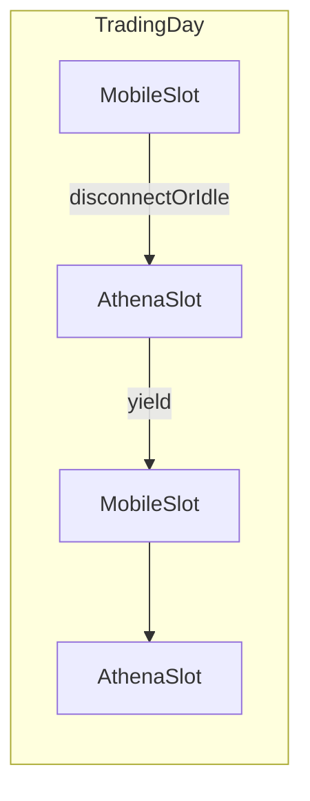

# 06 — Data Providers and IB

## Split of responsibilities

| Need | Primary | Secondary |
|------|---------|-----------|
| Realtime ping / price movement | **iTick** | IB only if iTick gap |
| Bars for tags (RSI, support/resistance) | iTick → local store | IB hist backfill |
| Long historical pulls | **IB** (in Athena slots) | — |
| Options chain / Greeks when subscribed | IB preferred; iTick if available | Cached snapshots |
| Account positions / cash / margin | **IB sync** | — |
| Order execution | **IB** | — |
| Ad-hoc human trades | **Mobile IB App** in reserved slots | Athena reconciles next sync |

Until profitable enough for extra IB market data subscriptions: lean on iTick for live quotes; use IB for what the account already allows + execution.

## Local store (“Athena Tick Store”)

Not a separate SaaS product named iTicksDB in-repo — a **local** Postgres/Timescale (name in code: `store`) fed by iTick + IB.

Core tables (from PRD, adapted): ticks/bars, options_chain, iv_history, positions, signals/drafts, news_events, settings_versions, approvals, orders/fills.

Retention sketch: ticks short; bars long; chains ~90d; Greeks/IV long; audit forever.

## IB session reality

Constraints you stated:

- Running Mobile IB App disconnects the trading tool API client  
- Need reconnection when Mobile session ends  
- Need time slots so you can browse and add ad-hoc trades on phone  
- Three segregated IB accounts under your name (multi-account schema; one active for MVP)

### Slot manager

Settings define:

- **`mobile_slots`** — Athena **must not** hold the Gateway API (or stays idle / disconnected)  
- **`athena_slots`** — Athena connects with fixed `client_id`, syncs, may execute approved orders  

Behaviors:

- Before Mobile slot: cancel/avoid new Athena API work; finish or park orders per Settings  
- On unexpected disconnect: exponential backoff reconnect **only inside Athena slots**  
- Heartbeat every N seconds while connected  
- Never fight Mobile for the session during Mobile slots  

### Sync jobs (Athena slots)

1. Positions + cash + margin → `positions` snapshot  
2. Open orders → reconcile vs Athena draft/order state  
3. Detect Mobile ad-hoc fills → ingest as `external_fill`, alert, update phase/risk  
4. Optional hist backfill for watchlist  
5. Options chain refresh for tagged symbols  

### Execution

- `ib_insync` (or ibapi) adapter in `apps/exec-ib`  
- Submit only when: privilege allows + Approve present (if required) + risk pass + inside Athena slot + Gateway healthy  
- Order types: limit DAY for opens; IOC/urgent for risk exits when privilege permits auto  

## Multi-account

| Field | Use |
|-------|-----|
| `account_ids[]` | All three IB accounts |
| `active_account_id` | MVP execution target |
| `account_role` | e.g. us_options_sleeve / hk_equity / europe — metadata only at first |

Schema supports segregation from day one; orchestrator MVP loops one active account. Cross-account capital moves stay manual.

### Configurable accounts (no hard-coded IBKR id)

Athena treats IB accounts as **config**, not baked-in identity:

- Required: `ATHENA_IB_ACCOUNT_ID=<whatever you set>`  
- Optional: `ATHENA_IB_ACCOUNT_IDS=id1,id2,id3` + Settings `active_account_id`  
- Optional later: `ATHENA_FANIT_ACCOUNT_ID` only for fanit export mapping  

fanit-cli labels (Primary / Relaxed / Defensive) are **examples** you may seed from — Athena must not assume a fixed account number.

**Live vs paper:** Brokerage account type is whatever IB gives you (live or paper gateway). Athena software mode (`paper` vs `approve_gated_live`) is independent and defaults to `paper` until you enable live submit.

## iTick client

Reuse ideas from fanit `itick.ts` / live pricing:

- Rate limits, symbol map, fallback provider chain later (Yahoo/Twelve if needed)  
- Writer service persists to local store for orchestrator (do not call iTick ad hoc from every rule)  

## Paper mode

- Same drafts and Approves  
- Fills simulated from quotes; no IB order submit  
- Still run IB sync read-only if useful for position realism, or use fixture portfolio  

## Open config (before first live order)

- [x] Account model = **configure any** `ATHENA_IB_ACCOUNT_ID`  
- Set the active account id in env/Settings for your Windows box  
- Finalize weekday slot calendar (timezone Asia/Hong_Kong or US/Eastern for US options hours)  
- Confirm Gateway port (4001 live / 4002 paper Gateway) vs Athena software `ATHENA_TRADING_MODE` 
