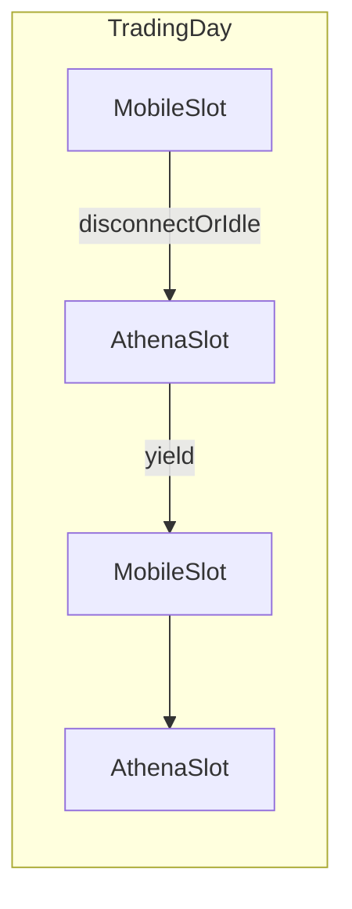

# 06 — Data Providers and IB

## Split of responsibilities

| Need | Primary | Secondary |
|------|---------|-----------|
| Draft reference price | Newest `ib-delayed` close, else the daily close | Not a rail input |
| Bars for tags (RSI, rails, realized vol) | **IB daily**, one row per calendar day | Same-day `ib-delayed` may update that day’s close only |
| Long historical pulls | **IB** (in Athena slots), target 252 sessions | Short history is marked, not padded |
| Options chain asks | IB, every expiry inside the DTE band | Cached `option_choices` |
| At-the-money mids | Appended to `chain_marks` on a live slot | Not read yet. A replay does not write them |
| Account positions / cash / margin | **IB sync** | — |
| Order execution | **IB** | — |
| Ad-hoc human trades | **Mobile IB App** in reserved slots | Athena reconciles next sync |

iTick may still store an hourly print under source `itick` when a key is set. That print is not a daily bar. A missing key writes nothing. Synthetic `seed` bars are not written.

## Daily bar contract

`pricing.daily_bars` is the only production reader of `market_bars` for a window.

- One bar per calendar day. Sources are `ib-daily` and `ib-delayed`.
- High, low, open, and volume come from `ib-daily` when that day has one. The close is the latest print of the day, so a delayed quote can move the close and cannot move the high or the low.
- Fewer than 252 `ib-daily` sessions sets `symbol_facts.history_short`. Range tags are then `HIGH_RANGE` and `LOW_RANGE`.
- Realized volatility for the rank is stored on `rv_marks` (`method` `close_log_252`). It is not backfilled.
- `iv_marks.method` exists so a future implied-vol sample cannot be ranked against the old premium ratio. No new method is written. `estimated_iv()` returns nothing.

Until profitable enough for extra IB market data subscriptions: lean on iTick for live quotes; use IB for what the account already allows + execution.

## Local store (“Athena Tick Store”)

Not a separate SaaS product named iTicksDB in-repo — a **local** Postgres/Timescale (name in code: `store`) fed by iTick + IB.

Core tables: `market_bars`, `option_choices`, `option_plans`, `chain_marks`, `rv_marks`, `iv_marks`, `symbol_phases` (tags, `indicators`, wheel snapshot), `tickets`, `decision_trails`, `ai_calls`, positions, drafts, news_events, settings_versions, approvals, orders/fills.

Retention sketch: ticks short; bars long; chain snapshots append-only; audit forever. `chain_marks` cannot be backfilled.

## IB session reality

Constraints you stated:

- Running Mobile IB App disconnects the trading tool API client  
- Need reconnection when Mobile session ends  
- Need time slots so you can browse and add ad-hoc trades on phone  
- Three segregated IB accounts under your name (multi-account schema; one active for MVP)

### Slot manager

Settings define:

- **`mobile_slots`** — Athena **must not** hold the Gateway API (or stays idle / disconnected)  
- **`athena_slots`** — Athena connects with fixed `client_id`, syncs, may execute approved orders  

Default windows, Hong Kong time:

| Window | Owner |
|--------|--------|
| 09:30–12:00 and 13:00–16:00 | Athena. HK cash. Lunch 12:00–13:00 stays idle |
| 19:00–21:30 | Mobile |
| 21:30–04:00 | Athena. US regular session while the US is on daylight time. From Monday 2 Nov 2026 this stored leg is read as 22:30–05:00 |

A window that ends earlier than it starts crosses midnight. The morning half belongs to the previous evening. Friday's US session stays open until Saturday 04:00. Monday before 04:00 stays closed, because Sunday has no US session. The stored string stays `21:30-04:00`. From Monday 2 Nov 2026 that exact leg is read as `22:30-05:00`.

`observe_slots` default `always` watches on a Hong Kong weekday from 07:00 through midnight. `draft_slots` default `athena` writes a ticket only inside an Athena window, including that Saturday morning tail. Mobile wins when a clock matches both.

Behaviors:

- Before a Mobile slot: avoid new Athena API work
- On unexpected disconnect: reconnect only inside an Athena slot
- Never fight Mobile for the session during Mobile slots  

### Sync jobs (Athena slots)

1. Positions + cash + margin → `positions` snapshot  
2. Open orders → reconcile vs Athena draft/order state  
3. Detect Mobile ad-hoc fills → ingest as `external_fill`, alert, update phase/risk  
4. Optional hist backfill for watchlist  
5. Options chain refresh for tagged symbols  

### Execution

- `ib_insync` (or ibapi) adapter in `apps/exec-ib`  
- Submit only when: privilege allows + Approve present (if required) + risk pass + inside Athena slot + Gateway healthy  
- Order types: limit DAY for opens; IOC/urgent for risk exits when privilege permits auto  

## Multi-account

| Field | Use |
|-------|-----|
| `account_ids[]` | All three IB accounts |
| `active_account_id` | MVP execution target |
| `account_role` | e.g. us_options_sleeve / hk_equity / europe — metadata only at first |

Schema supports segregation from day one; orchestrator MVP loops one active account. Cross-account capital moves stay manual.

### Configurable accounts (no hard-coded IBKR id)

Athena treats IB accounts as **config**, not baked-in identity:

- Required: `ATHENA_IB_ACCOUNT_ID=<whatever you set>`  
- Optional: `ATHENA_IB_ACCOUNT_IDS=id1,id2,id3` + Settings `active_account_id`  
- Optional later: `ATHENA_FANIT_ACCOUNT_ID` only for fanit export mapping  

fanit-cli labels (Primary / Relaxed / Defensive) are **examples** you may seed from — Athena must not assume a fixed account number.

**Live vs paper:** `ATHENA_TRADING_MODE` is `paper` or `live`. Paper uses `ATHENA_IB_PAPER_ACCOUNT_ID` and places a real order on that paper account after Approve. Live uses every id in `ATHENA_IB_ACCOUNT_IDS`. The Gateway port stays the one you logged in (`4002` paper, `4001` live). Athena does not switch the port.

## iTick client

Reuse ideas from fanit `itick.ts` / live pricing:

- Rate limits, symbol map, fallback provider chain later (Yahoo/Twelve if needed)  
- Writer service persists to local store for orchestrator (do not call iTick ad hoc from every rule)  

## Paper mode

- Same drafts and Approves  
- After Approve, Athena sends a real limit order to the paper account  
- An empty live account list logs and skips orders. Nothing from the other book is deleted  

## Open config (before first live order)

- [x] Account model = **configure any** `ATHENA_IB_ACCOUNT_ID`
- [x] Slot calendar = HK cash plus the US regular session, Hong Kong clock, with the overnight rule above
- Set the active account id in env/Settings for your Windows box
- Confirm Gateway port (4001 live / 4002 paper Gateway) vs Athena software `ATHENA_TRADING_MODE` 
