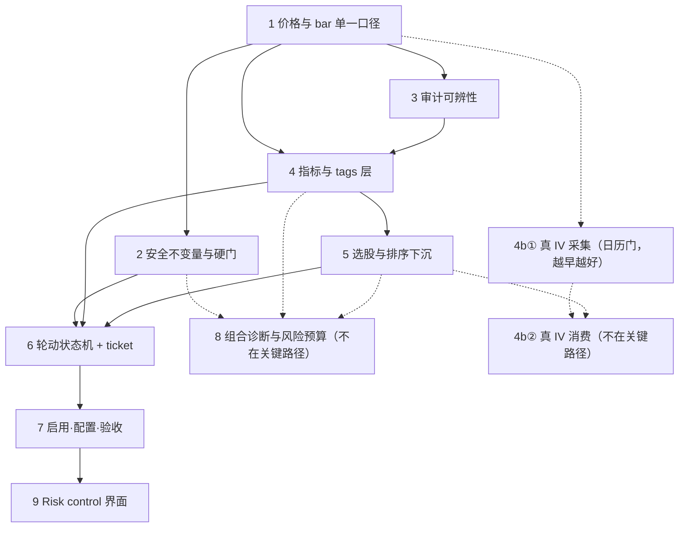

# Athena 信号入场改造 · 主计划（Plan Order）

> **性质：只做计划、决定与方案。本套文档不含任何实现，也不授权实现。**
> 每一步先定方案与决策，经确认后才进入开发；开发前不动代码。
>
> **依据**：`docs/ds_v4_flash_athena_strategy_review_2026-10-10.md`（deepseek-v4.1-flash 评审）。
> 本计划的每一条步骤都能反查到评审中的一条取证。
>
> **文档语言**：本套计划文档用中文；代码标识符、表名、tag 名保持英文原样，便于直接落码。

---

## 1. 目标与验收定义

目标（用户原话收敛为可执行判据）：**让 Athena 能检测信号，产出 Long / CSP / CC 的草案，单个或多个；CC 只在持股存在时出现。**

拆成三条硬判据，缺一不算达成：

| # | 判据 | 可执行形式 |
| --- | --- | --- |
| G1 | **能开口** | 在一个刻意构造的"有序回调"序列上，paper 账本出现一条 `BUY` 草案与一条 `OPEN_CSP` 草案（同一标的、同一批） |
| G2 | **能收口** | 在持股存在且价格进入区间上沿的序列上，出现一条 `OPEN_CC` 草案，且**行权价 ≥ 持仓成本** |
| G3 | **不会失控** | 在无持股、无合法状态、无数据、模型输出不可解析这四类输入下，**不产生任何可提交的裸卖单**，且审计能分别识别出这四类 |

G3 是前置约束，不是加分项：任何一步若使 G3 退化，该步不予验收。

---

## 2. 排序原则

1. **先让系统"看得对"** —— 一切判断都建立在"当前价格 / 当前日线"之上。口径不对，后面每一步的验收都会作废重做。
2. **再让系统"不会犯错"** —— 任何能产出可提交订单的路径，必须先坐在硬性不变量之后。当前开口路径是关闭的，风险是潜在的；一旦打开就是实时的。
3. **再让系统"能自证"** —— 后面所有步骤靠审计来验收；审计分不清"没数据"和"没信号"、分不清"模型没说话"和"模型说错了"，验收就没有依据。
4. **最后才动策略内核** —— 状态机与选股是重量级改造，必须站在"数据对、门禁在、审计清"的地基上，否则改完无法归因。
5. **每步都必须能独立回滚**，且回滚不需要回滚前序步骤。

---

## 3. 步骤总表

| 步 | 名称 | 解决的问题（评审编号） | 依赖 | 可并行 | 分册 |
| --- | --- | --- | --- | --- | --- |
| **1** | 价格与 bar 单一口径 | 3.11（数据源分歧）、3.5（52 周轨道退化） | — | — | [01-price-single-source.md](01-price-single-source.md) |
| **2** | 安全不变量与硬门 | 3.2（裸卖 CC）、3.3（冲突规则禁排列）、3.7（批量风险） | 1 | 与 3 并行 | [02-safety-invariants.md](02-safety-invariants.md) |
| **3** | 审计可辨性 | 3.8（quiet ≡ broken）、3.9（成本与噪声） | 1 | 与 2 并行 | [03-audit-discernibility.md](03-audit-discernibility.md) |
| **4** | 指标与 tags 层 | 3.4（IV 反相**去伪**）、3.6（六月 dip 不可表达）、3.5（残余） | 1、3 | — | [04-indicator-tags.md](04-indicator-tags.md) |
| **4b①** | **真 IV 采集（D4b-采集，新增）** | 3.4 的**根因**（分子冻结）—— 分子必须随市场刷新 | 1 | **已落地（2026-10-11）**。不在关键路径；20 个交易日从下一个实盘 slot 起算 | [04](04-indicator-tags.md) §3.1.4 |
| **4b②** | **真 IV 消费（D4b-消费，新增）** | 让 `IV_RICH` / `IV_CHEAP` 真正可用 | 4b①（同 method 样本 ≥ 20）、5 | 不在关键路径。**未做** | [04](04-indicator-tags.md) §3.1.4 |
| **5** | 选股与排序下沉到代码 | 3.11（one expiry one shot）、Q1（agent 看不到数字）、**新增：`strangle_otm_pct=10` 丢掉全部 10% 以内的行权价** | 4 | — | [05-screener-metrics.md](05-screener-metrics.md) |
| **6** | 轮动状态机 + ticket | 3.1（开不出仓）、3.6、3.7（排列一等公民） | 2、4、5 | — | [06-wheel-state-machine.md](06-wheel-state-machine.md) |
| **7** | 启用、配置与验收 | 3.1、3.10（Long 配置不可达）、3.11（文档漂移） | 6 | — | [07-enablement-acceptance.md](07-enablement-acceptance.md) |
| **8** | 组合诊断与跨标的风险预算 | **新增**：无跨标的配给、无集中度约束、I2 仅 ticket 级 | 2、4、5 | **已落地（2026-10-11）** | [08-portfolio-diagnostics.md](08-portfolio-diagnostics.md) |
| **9** | Risk control 界面（D4a / D39） | 3.4 的**可见性**（反相长期存活因界面不显示它） | 4、7 | — | [09-risk-control-ui.md](09-risk-control-ui.md) |

**关键路径**：1 → 4 → 5 → 6 → 7 → 9。步 2 与步 3 可与 4 并行推进，但**必须在步 6 之前全部完成**——步 6 会第一次真正打开"合法开仓"，2 与 3 是它的入场券。

**另一条日历门轨道（不阻塞、但越早越好）**：**1 → 4b① 采集**。

- **为什么要单独说**：步 4b① 的成本是**日历**而不是工时 —— `chain_marks` 无历史、**不可回填**，且 rank 需 20 个同 method 样本，所以"上线 → 有 IV"之间固定隔着 20 个交易日。**这段静默期无法用加班压缩**，只能靠早点开始计时。这也是把采集从关键路径里拉出来、挂到步 1 之后的唯一理由：它早一天跑，`IV_RICH` 就早一天存在，而它对下游零影响（只写自己的表）。
- 步 4b② 的**消费**端（解 BS → `IV_RICH` / `IV_CHEAP` 标签）仍排在**步 5 之后** —— 它要接进步 4 的 tag 词汇表和步 5 的选股口径，在两者定型前接进去会返工。

**步 9 的性质**：它在关键路径末端。`paper` 档与 D36 的换轴改名已在步 7 落地，旋钮在现有风控表。本步仍负责 Volatility reading 卡（把该旋钮与 `rv_high_pctl` 放在一起）、反相证据页，以及 D39。

**步 8 的性质不同**：它不由评审的缺陷驱动，而由"跨标的视角完全缺失"驱动。其中三条约束（I4/I5/I6）进核心逻辑，一张面板为只读诊断。它不阻塞任何一步，也不被任何一步阻塞（只依赖 2/4/5）。**主计划建议：M3 达成后再启动步 8**，因为 I5 的桶上限在当前 71% 的 `AI_NARRATIVE` 集中度下会立刻成为紧约束（见 08 册 §2.3）。

---

## 4. 依赖图

---

## 5. 各步摘要

### 步 1 — 价格与 bar 单一口径

全库目前有 **6 套互不相同的"当前价格"规则**，其中 `agents._bars` 完全不筛 source，把合成 `seed` bar（NVDA/QCOM/T 各 15 条、值为常数的假 bar）与小时级 `ib-delayed` 混进"63 个交易日"窗口。实测 NVDA：窗口 63 行里只有 29 行是真日线，窗口低点算出 **208.93**，而真日线口径是 **190.01** —— 差 10%，足以把 `LOWER_RAIL` 从"不触发"变成"触发"。本步定义唯一真源，并统一读法。

**落地（2026-10-11）**：读路径收进 `pricing.py`。一日一根；同日 delayed 只改 close。`seed` 与 `pool-sync` 已删。不足 252 日的标的标 `history_short` 并用 `HIGH_RANGE`。详见 [01](01-price-single-source.md)。

### 步 2 — 安全不变量与硬门

`OPEN_CC` **没有任何持股前置校验**：`_drafts` 只对 `BUY` 校验 flags，`stage_draft` 只查"冲突空头"，`contracts` 也不受 `shares/100` 约束。账面 MRVL/QCOM/T 各持 1 股，模型一旦提案即成裸卖 call。同时 `_has_short` 会阻断同标的一切开仓，使"空头 put ＋ 持股 ＋ 空头 call"这个轮动常态不可表示。本步把三件事变成代码铁律：持股覆盖、ticket 批量风险、状态感知冲突规则。

**落地（2026-10-11）**：三门已在 `drafts` 与 `athena_risk.block_ticket_reason`。轮动组合放行；`strict_conflict` 可收回。详见 [02](02-safety-invariants.md)。

### 步 3 — 审计可辨性

`parse_json` 解析失败返回 `{}`，`_drafts` 把 `{}` 记为 `quiet` —— 模型崩了和真没信号在审计里长得一样。本步把"没数据 / 没信号 / 模型输出不合法"三态分开，加一次 schema 重试，并预过滤不合格标的以省掉无效调用。

**落地（2026-10-11）**：`drafted` / `quiet` / `no_data` / `invalid` 已分开，非法回复重试一次。迁移 `033` 加了 CHECK。预过滤下限是 63 根，不是 252。详见 [03](03-audit-discernibility.md)。

### 步 4 — 指标与 tags 层

`iv_proxy = (put_limit + call_limit) / close`，分子取自**永不变化的静态** `option_plans`，因此**实测 `iv_proxy ≡ credit/underlying`（逐行恒等，误差 1e−21）、`corr(iv_proxy, 1/underlying) = 1.000000`** —— 代理 ∝ 1/price，`HIGH_IV` 实际含义是"价格低"，语义反相，且与 `LOWER_RAIL` 重复计数。本步先把反相的量**从判据里摘除**（`HIGH_IV` 不再进 `_panic()`，改用对价格缩放不变的 `RV_HIGH/RV_LOW`），并补齐真正需要的确定性指标（`DIP_BOUGHT`、趋势斜率、`rail_pos`、回撤区间、量能枯竭、ATR、财报倒数、市场 regime），统一 Engine A 与 Engine B 的 tag 词汇表。

> **本步不产出 IV**（D4a）。早前版本曾设想"用 ATM 跨式近似反推 IV 即可消除反相"，**实测证伪**：因 `credit` 与 `expiry` 每 symbol 各只有一个取值，该近似退化为**正线性缩放**，`iv_rank` 逐位不变。真 IV 移交**步 4b**。

**落地（2026-10-11）**：D4a 已落地（A1–A9）。`estimated_iv()` 仍返回 `None`。**4b① 已落地**：实盘 slot 只追加 `chain_marks`，不写 IV。**4b② 未做。** Risk 页 sanity 列（A10）仍属步 9。详见 [04](04-indicator-tags.md)。

### 步 5 — 选股与排序下沉到代码

每条 listed line 目前只给模型 `expiry / right / strike / limit` 四个裸值。本步在代码里算出 delta 代理、DTE、OTM 距离、年化收益、流动性，只把 top 2–3 条**带数字**的线喂给 agent —— 这是业界标准做法，也是让"落点"可被定义、可被审计的前提。

**本步新增的关键修正（D37/D38）**：`strangle_otm_pct = 10` 不是"以 10% 为中心取带"，而是 `strike <= 0.9·S` 的**硬切**再加取最近 4 档 —— 于是**所有 10% 以内的行权价被直接丢弃**。实测七个标的的阶梯**全部落在 10% 之外**（`NVDA` 最浅 put 在 −10.59%，205 与现价之间是空的）。这与实务口径冲突：30–45 DTE 的 strangle 实务上按**约 28–29 delta**（≈ `0.5·σ√T`）定，宽度随波动率变化 —— 操作者给的三个数点（`MRVL` 上下各 7–10%、`NVDA`/`AAPL` 约 5%）用 `RV20` 即可复现（详见 [05](05-screener-metrics.md) §2.7）。故本步把行权价带从"固定百分比"改为**按波动率缩放的 delta 目标**，`strangle_otm_pct` 降级为"候选发现"参数并更名 `chain_band_pct`。

**落地（2026-10-11）**：`screener.candidates` 按目标 delta 排序，发现带宽默认 25、宽度 8，带内每个到期日都存 ask。护栏 3%–20%，夹紧写入审计 `otm_clamped`。三档倍数在 Strategy 卡片上，文案标明是假设。`estimated_iv()` 仍返回 `None`。波动率阅读卡仍属步 9。详见 [05](05-screener-metrics.md)。

### 步 6 — 轮动状态机 + ticket

把"标的"从"四个互不相干的 agent"改造成**单一状态机**。开仓由代码决定。一张 ticket 是有序的腿。模型只剩 Location、News、Narrator。

**落地（2026-10-11）**：默认开启。`ATHENA_STATE_MACHINE=off` 回到旧路径。已有 strangle 信号且持股至少 100 时，一张票先 put 后 call。裸 call 与冲突账本不自动平仓。验收是 ZZTEST 夹具。迁移是 `038` / `039`。详见 [06](06-wheel-state-machine.md) §0。

### 步 7 — 启用、配置与验收

**落地（2026-10-11）**：观察与草案已拆开。`may_buy` 与意图分开。`fixture_june_dip` 与 `fixture_intc_high` 已有。五态各有一条夹具。`paper` 档已在 `ZZTEST` 上保存并恢复，活账户仍是 `test`。现有六个开关关掉后仍写审计。多日影子对照是操作步骤。Volatility reading 卡仍是步 9。详见 [07](07-enablement-acceptance.md) §0。

### 步 4b — 真 IV：采集与消费（非关键路径，新增）

步 4 把反相的量从判据里摘除了，但**没有换来 IV**。根因是**分子冻结**：`option_plans` 每标的一行静态 `put_limit + call_limit`，任何比值都只能是 `1/S` 的单调函数。要得到与价格无关的波动率量，**分子必须随市场刷新** —— 每个 cycle 从链上取最接近 ATM 的 call/put 的 mid，落进新表 `chain_marks`（迁移 `035`），再解 Black–Scholes 得 σ。本步**只给设计、不实施**（详见 [04-indicator-tags.md](04-indicator-tags.md) §3.1.4）。

**按裁定拆为两段，日期不同**：

| 段 | 内容 | 依赖 | 为什么在这里 |
| --- | --- | --- | --- |
| **4b① 采集** | 迁移 `035` + 每 cycle 快照 job，**只写表，无下游读取方** | 步 1 | **已落地（2026-10-11）**。无历史、不可回填，20 个交易日从下一个实盘 slot 起算 |
| **4b② 消费** | 解 BS → `estimated_iv()` 返回真值 → 定义 `IV_RICH` / `IV_CHEAP` | 4b①（同 method 样本 ≥ 20）、步 5 | 要接进步 4 的 tag 词汇表与步 5 的选股口径；提前接会返工 |

> **为什么拆而不并**：采集是"接新数据"，消费是"改判据"。合并会让消费被采集的 20 日静默期拖着走；拆开后采集可以立刻开跑、消费在数据就绪时再上。这也是唯一一处**故意提前**的工作 —— 因为它的瓶颈是日历不是人力。

### 步 8 — 组合诊断与跨标的风险预算（非关键路径）

**落地（2026-10-11）**：一轮草稿出来之后，按平仓、`dip_long`、`high_cc`、其余检查现金、保证金、单量、桶和指派。上限 35 / 40 / 10 / 0.30，开关默认开。`/book` 只读，用 `RV20`，不画市场线。没有新表。详见 [08-portfolio-diagnostics.md](08-portfolio-diagnostics.md)。

### 步 9 — Risk control 界面（D4a / D39）

`paper` 档与十项身份判定已在步 7 落到 `/risk`。本页剩下的是把口径事实显示出来。**D4a**：本页最有价值的一列是 `sanity = corr(iv_proxy, 1/underlying)` —— **活数据下它今天应显示 7/7 ⚠ `INVERTED?`**，这不是故障，而是**面板当场证明旧口径反相**；D4b 上线后它须由红转绿，**这个转变本身就是 D4b 的验收**。本册同时删除一个假选项（`straddle_iv`，恒等变换、改了红灯不会变绿）。详见 [09-risk-control-ui.md](09-risk-control-ui.md)。

---

## 6. 关键决策清单（需拍板）

以下决策会改变后续 spec。每条给出推荐，但**最终由你裁定**；未裁定的项在对应分册里以「待决」标注，不阻塞其余部分。

| # | 决策 | 选项 | 推荐 | 归属步 |
| --- | --- | --- | --- | --- |
| D1 | **日线唯一真源** | (a) 仅 `ib-daily` 为日线真源，盘中价另开命名空间 (b) 合并 `ib-daily` + `ib-delayed` 取最新 | **(a)**。日线窗口只许日线进入，盘中价另立 `last_intraday` 概念 | 1 |
| D2 | **合成 `seed` bar 的处置** | (a) 从 `market_bars` 删除并禁止再写 (b) 保留但所有读路径排除 | **(a)**，并保留 `SEED_CLOSE` 仅作单元测试夹具 | 1 |
| D3 | **历史长度目标** | ≥252 交易日 / ≥300 交易日 / 视 vendor 上限 | **≥252 交易日**；不到就**改 tag 名**（`HIGH_52W` → `HIGH_RANGE`），不假装 | 1 |
| **D4a** | **本步是否引入 IV 口径** | (a) `RV × 倍数` (b) 接 IB 链 IV (c) 跨式近似反推 **(d) 本步不引入，只去伪 + 留接口** | **✅ 裁定：(d)**。实测：(c) 因**分子冻结**退化为**正线性缩放**，`iv_rank` 逐位不变；`option_choices` 无 bid/ask/mid/IV 列，(b) 物理上取不到 | 4 |
| **D4b** | **真 IV 的获取路线与排期** | 每 cycle 采 ATM 链 mid → `chain_marks` → 解 BS 得 σ；排期(a) 整步延后 (b) **只提前采集** (c) 采集+消费一起提前 | **✅ 裁定：只提前采集（b）** —— 采集挂步 1 之后（静默期即刻计时），消费留步 5 之后 | 4b① / 4b② |
| D5 | **合法短仓组合集** | 是否允许同标的同时存在 short put 与 short call | **允许**（这是轮动常态）；但禁止双空 call 与无覆盖 call | 2 |
| D6 | **CC 持股粒度** | contracts ≤ `floor(shares/100)`；不满 100 股时 | **拒绝并给出明确原因文本**，不静默放过 | 2 |
| D7 | **ticket 实体化方式** | (a) 新表 `tickets` + `drafts.ticket_id` (b) 仅用同批次 id 分组 | **✅ 裁定并落地：(a)**。表在 `038_tickets.sql` | 6 |
| D8 | **开仓时段语义** | (a) 扫描全天、开仓许可仍限 Athena slot（可配置）(b) 完全放开时段 | **✅ 裁定并落地：(a)**。工作日 07:00 至午夜观察，草案仍限 Athena slot | 7 |
| D9 | **Long 可达方式** | (a) 逐标的设 `intent=accumulate` (b) 新增 `may_buy` 与 intent 正交 | **✅ 裁定并落地：(b)**。缺省是 Long 且意图不是 Income，不是「必须 accumulate」 | 7 |
| **D36** | **`min_iv_rank_new_short` 在 D4a 期间怎么办** | (a) 改指向 `rv_pctl` 并重命名 (b) 保留现状、改名说明为"价格位置过滤" (c) 临时置 0 | **✅ 裁定并落地：(a)**。字段已改名，读 `rv_pctl`。`paper` 档为 40。与 `rv_high_pctl` 同卡仍是步 9 | 7 / 9 |
| **D37** | **行权价带的口径** | (a) 固定 `strangle_otm_pct = 10` (b) 固定调小（如 5）(c) **按 `σ_ref × 0.5 × √T` 缩放、以 delta 目标选档** (d) 纯 delta、无护栏 | **✅ 裁定：(c)** —— `strangle_otm_pct` 更名 `chain_band_pct`（发现带宽 25），选择由 `screener.candidates` 按目标 delta 做，护栏 `[3%, 20%]` | 5 |
| **D38** | `iv_rv_multiple` 的取值与它算什么 | (a) 写死代码 (b) **进 Settings，按 `RV20` 三档默认 1.05 / 1.35 / 1.80，标注"假设非测量"** (c) 全取 1.0 | **✅ 裁定：(b)** | 5 |
| **D39** | **行权价带的字段放在哪张卡片** | (a) 单开"Strangle band"卡片 (b) 并入 `Volatility reading` (c) 放回原 `strangle_otm_pct` 的位置 | **✅ 裁定：(b)** —— 与 `rv_window` / `rv_high_pctl` / `rv_low_pctl` 同卡 | 9 |
| D10 | **Engine A 的 `choose_tactic`** | (a) 删除 OPEN_* 分支，只留 phase + tags (b) 保留但现在这样改写成 HOLD | **✅ 裁定并落地：(a)**。`phases.py` 不再写开仓 tactic | 6 |
| D11 | **LLM 的权限边界** | (a) LLM 只能提名，合法性与尺寸由代码定 (b) LLM 可否决合法提案 | **✅ 裁定并落地：(a)**。Narrator 只能解释或换一条已列出的行权价 | 6 |

**决策总数：D1–D39。** 上表是**跨步**的主干决策（其中 **D4 已拆为 D4a / D4b**）；其余是各步在细化时新发现的（D12 保证金估计式、D13 重试次数、D14 CHECK 约束、D15 预过滤阈值、D16 指标落库、D17 IV 旧名退场、D18 regime 缺数据、D19 delta 算法、D20 流动性列、D21 top-N、D22 成本价口径、D23 状态落库、D24 收缩程度、D25 腿数上限、D26 验收档位、D27 验收工装、D28 观察窗口、D29 面板形态、D30 风险轴口径、D31 相关性表达、D32 三条约束取值、D33 `PROFILES` 结构、D34 口径的 UI 权限、D35 Portfolio budget 卡片时机、**D36 `min_iv_rank_new_short` 的反相余毒**、**D37 行权价带口径**、**D38 `iv_rv_multiple`**、**D39 带的字段归属**）。逐条定义在对应分册的「决策点」小节：

| 决策 | 所在分册 |
| --- | --- |
| D1 / D2 / D3 | [01](01-price-single-source.md) |
| D5 / D6 / **D12** | [02](02-safety-invariants.md) |
| D13 / D14 / D15 | [03](03-audit-discernibility.md) |
| **D4a / D4b** / D16 / D17 / D18 | [04](04-indicator-tags.md) |
| D19 / D20 / D21 / D22 / **D37 / D38** | [05](05-screener-metrics.md) |
| D7 / D10 / D11 / D23 / D24 / D25 | [06](06-wheel-state-machine.md) |
| D8 / D9 / D26 / D27 / D28 / **D36** | [07](07-enablement-acceptance.md) |
| D29 / D30 / D31 / D32 | [08](08-portfolio-diagnostics.md) |
| **D33 / D34 / D35 / D39** | [09](09-risk-control-ui.md) |

**已裁定**（2026-10-10，两轮）：

| 轮次 | 裁定 | 落地步 |
| --- | --- | --- |
| 一 | **D26**（`paper` 档按 07 册建议值）、**D4a**（本步不引入 IV，只去伪 + 留接口） | 7（D26 已落地，活账户未切换）／4（D4a 已落地） |
| 二 | **D4a/D4b 拆分**（确认）、**D36 (a)**（换轴改名）、**D37 (c)**（按波动率缩放的 delta 目标）、**D38 (b)**（进 Settings 标"假设"）、**D39 (b)**（并入 `Volatility reading`）、**D4b (b)**（只提前采集） | D4a 已落地。D37 / D38 已随步 5 落地。D36 的换轴已在步 7 落地，同卡仍是步 9。D39 仍未落地。4b① 采集已落地，4b② 未做 |

**步 1–4 已落地的决策**（2026-10-11，按代码，不单按推荐）：

| 决策 | 落地 |
| --- | --- |
| D1 | 一日一根。同日 `ib-delayed` 更新 close，high/low 留 `ib-daily` |
| D2 (a) | 迁移 `027` 删除 `seed` 与 `pool-sync` |
| D3 | 不足 252 日记 `history_short`，tag 改为 `HIGH_RANGE` |
| D5 | 允许 short put 与 covered call 并存；`strict_conflict` 可收回 |
| D6 | 覆盖不足则拒绝，并写明缺多少股 |
| D12 (a) | `margin_rate` 默认 20% |
| D13 | 非法回复重试 1 次 |
| D14 (a) | 迁移 `033`，含第五态 `observed` |
| D15 | 预过滤下限 **63** 根（未绑 252） |
| D16 (a) | `symbol_phases.indicators` jsonb |
| D17 (a) | `HIGH_IV` / `LOW_IV` 保留别名，不再产生 |
| D18 | regime 指数 `SPY`；缺 bar 记 `regime_unknown` |
| D19 (a) | Black–Scholes delta，`r = 0` |
| D20 (a) | `option_choices` 可空的 bid / open interest / volume / iv，暂不写入 |
| D21 | 每张表最多 3 行，少则全给 |
| D22 (a) | 备兑底价是持股 `avg_price` |
| D37 (c) | 发现带宽 `chain_band_pct` 默认 25；卖出距离按波动率宽度 |
| D38 (b) | 三档倍数在 Settings，文案标明是假设 |

**步 6 已落地的决策**（2026-10-11）：D7、D10、D11、D23、D24、D25，都按推荐。另有四条不在原稿表里的裁定：没有 `CALLED_AWAY`；1–99 股是 `ODD_LOT`，covered call 仍拒绝；收入型回调可单独开 put；奇数股在高位时草案买满 100 股的缺口。

**步 7 已落地的决策**（2026-10-11）：D8 (a)、D9 (b)、D26 (b)、D28、D36 (a)。D27 只落地了干跑开关。D9 的缺省是 Long 且意图不是 Income。活账户没有切到 `paper`。

**其余待决**（D33–D35）。D29–D32 已随步 8 落地。D5 与步 6 已落地，不再悬空。

---

## 7. 追溯矩阵（评审问题 → 步骤）

| 评审条目 | 问题摘要 | 解决于 |
| --- | --- | --- |
| §3.1 | 什么都开不出来（两处独立原因） | 6 + 7 |
| §3.2 | CC 无持股硬门，可裸卖 | **2** |
| §3.3 | 冲突规则禁掉轮动排列 | **2** |
| §3.4 | IV 代理语义反相、粒度退化 | **4（去伪）** + **4b①采集／4b②消费（真 IV）** + 9（可见性） |
| §3.5 | "52 周"轨道实为约 69 根 | 1 + 4 |
| §3.6 | 六月式 dip 不可表达 | 4 + 6 |
| §3.7 | 排列非一等公民、无批量风险 | 2 + 6 |
| §3.8 | quiet 与 broken 同色 | 3 |
| §3.9 | 无效调用多、审计噪声大 | 3 |
| §3.10 | 配置层堵死 Long | 7 |
| §3.11 | 数据源分歧 / 单到期 / 文档漂移 | 1 / 5 / 7 |
| **新增** | 跨标的资金分配完全缺失；I2 只做 ticket 内汇总；71% 的 watchlist 同属 `AI_NARRATIVE` 而无人可见 | 8 |
| **新增** | `strangle_otm_pct = 10` 是硬切而非中心带，七个标的的候选阶梯**全部落在 10% 之外**（`NVDA` 最浅 put −10.59%，与现价之间为空）；实务口径（30–45 DTE ≈ 28 delta）要求 `AAPL` ~5%、`MRVL` 7–10%，即**带宽必须随波动率变化** | 5（D37/D38） |
| Q1 | 提示词信息不足（CSP 无趋势质量、Call 无成本、Consolidator 无资金） | 4、5、6 |
| Q4 | 可加的指标 | 4 |

---

## 8. 里程碑

| 里程碑 | 含义 | 完成条件 |
| --- | --- | --- |
| **M0 看得对、说得清** | 系统对"价格"与"发生了什么"不再自欺 | 步 1 + 步 3 完成，且能证明：① 同一标的在全库只有一套日线口径；② 审计能区分**五类**结果（`drafted` / `quiet` / `no_data` / `invalid` / `observed`） |
| **M1 开得安全** | 任何开仓路径都坐在不变量之后 | 步 2 完成，G3 的四个负面用例全部通过 |
| **M2 挑得好** | 标的与落点由数字决定，而非模型直觉 | 步 4 + 步 5 完成，每条提案都能引用至少一个计算值 |
| **M3 走得起轮动** | 目标达成 | 步 6 已落地。步 7 的配置已落地，`paper` 档已可选。G1 与 G2 尚未在 `paper` 档上端到端通过。步 9 仍负责波动率卡与反相证据页 |
| **M4 赌注看得见、兜得住**（非关键路径） | 跨标的视角补齐 | 步 8 完成：I4 跨 ticket 配给生效（A1/A2）、I5 桶上限可约束、I6 指派后可承受；面板能一屏回答"现在赌几个因子" |

---

## 9. 明确不做（本套计划边界）

- **不写实现**。本套文档只到"方案 + 决策 + 修改逻辑"，不含可合并的代码。
- **不引入新策略产品**。仍是单一 NFR 策略，Long / CSP / CC 是它的腿。
- **不放开自动下单**。`all_orders` + 人工 Approve 不变。
- **不接新数据源**，**唯一例外是步 4b①**（为取真 IV 而采集 ATM 链 mid 到 `chain_marks`）。该例外**不在关键路径，但已裁定提前启动** —— 因为它的瓶颈是 20 个交易日**日历静默期**而非工时，且只写自己的表、对下游零影响。**只提前采集，不提前消费**（消费端仍排步 5 之后）。其余仍只扩展既有 IB 拉取窗口以满足 D3 的历史长度。
- **不动 fanit 同步**、不动云端部署。
- **不重建 Engine A 的相位机**。P1–P5 保留为上下文，只删它的开仓分支（D10）。
- **不做组合优化**。不实现均值-方差、最大 Sharpe、风险平价、Black–Litterman，也不估期望收益或 31×31 协方差。组合视角只以**约束**（I4/I5/I6）与**只读诊断**（步 8 的面板）两种形态存在；理由见 [08](08-portfolio-diagnostics.md) §3.3。
- **不伪造 IV**。步 4 期间 `estimated_iv()` 恒返回 `None`；任何以 `credit` 比值为基础的"IV"（含跨式近似）都属禁止项，因为它只能表达 `1/price`。

---

## 10. 全局风险与回滚

| 风险 | 说明 | 对策 |
| --- | --- | --- |
| 顺序被打乱 | 先做状态机、后修数据口径 → 状态机建在错误的价格上 | 依赖图为准；步 6 的门槛是 1/2/3 全绿 |
| 回滚需要连带回滚 | 若某步同时改了 schema 与逻辑 | 每步一次迁移、一次逻辑变更，**可单独回滚**；迁移一律向后兼容（加列/加枚举，不删列） |
| 验收靠"看起来对" | 没有可执行判据 | 每步分册的「验收标准」必须是可运行的命令或 SQL |
| 未知 tag 静默携带 | 新增指标后，未注册的 tag 会被带入审计与 prompt | 步 4 的 tag 注册表要求未知 tag 记 warning 并留痕 |
| 决策悬空 | 决策点未拍板导致 spec 分叉 | 第 6 节的 **D1–D39** 逐条裁定后，才进入对应步的开发。**步 1–7 的已裁定项已随代码落地**（D1–D3、D5–D12 中已列各项、D8、D9、D16–D18、D23–D26、D28、D36、D37、D38；D15 取了 63 而非 252）。**4b① 采集已落地，4b② 未做。** **已裁定但未落地**：D39（Volatility reading 卡）。D27 的夹具已落地，多日影子对照仍是操作步骤。其余待决 |
| **日历门被工时思维掩盖** | 步 4b① 的 20 个交易日静默期既不能加班压缩、也不能回填，一旦排到关键路径末端，`IV_RICH` 就会在整套改造完成后才开始计时 | 把它从关键路径拉出来挂到步 1 之后（本册 §3 的"日历门轨道"）；采集段**无下游读取方**，因此提前启动零风险 |
| **反相被"假修复"掩盖** | 最危险的失败模式：有人用一个恰好也是 `∝1/S` 的公式（如跨式近似）宣称修好了反相，而 `iv_rank` 逐位不变 | 步 4 的 A2（`phases.py` grep 零命中）、A3（**缩放不变性**检验）；步 9 的 A7③（套跨式近似后 `sanity` **仍须为 ⚠**）；以及步 9 §3.4 第 6 条禁止假旋钮 |
| **"假设"被当成"测量"** | 步 5 的 `iv_rv_multiple` 是操作者知识，一旦被下游（prompt / `IV_RICH` / 界面）当作 IV，整条 D4a 的诚实性就没了 | 04 册 §3.1.6 三条硬约束（不得称 IV、不得用于 `IV_RICH`、必须在 Settings 标注 assumption）；05 册 D37/D38 与 A15；09 册 A12 |

---

## 11. 分册索引

| 文档 | 内容 |
| --- | --- |
| [01-price-single-source.md](01-price-single-source.md) | 价格与 bar 单一口径（含 6 套口径清单、seed 污染取证、唯一真源定义） |
| [02-safety-invariants.md](02-safety-invariants.md) | 持股覆盖硬门、ticket 批量风险、状态感知冲突规则 |
| [03-audit-discernibility.md](03-audit-discernibility.md) | 回复 schema 校验＋重试、四态审计、预过滤 |
| [04-indicator-tags.md](04-indicator-tags.md) | **D4a：IV 反相去伪**（含恒等变换证伪）、新增指标、词汇表统一、结构化 tags。**4b① 采集已落地**（只追加 `chain_marks`）。**4b② 消费**留步 5 之后，未实施 |
| [05-screener-metrics.md](05-screener-metrics.md) | 每条 listed line 的指标计算与 top-N 筛选；**D37/D38：行权价带从固定 10% 改为按波动率缩放的 delta 目标**（含操作者实务口径的复现验证） |
| [06-wheel-state-machine.md](06-wheel-state-machine.md) | 轮动状态机、合法迁移表、ticket、LLM 角色收缩。**已落地（2026-10-11）**，见该册 §0 |
| [07-enablement-acceptance.md](07-enablement-acceptance.md) | slot 语义、Long 可达、`paper` 档、D36 换轴。**已落地（2026-10-11）**，见该册 §0。多日影子对照仍是操作步骤 |
| [08-portfolio-diagnostics.md](08-portfolio-diagnostics.md) | cycle 级配给 I4、因子桶上限 I5、指派暴露 I6、只读 `/book`。**已落地（2026-10-11）**。EF/CML/切点不进核心逻辑 |
| [09-risk-control-ui.md](09-risk-control-ui.md) | **D4a 反相证据页**（`sanity` 列）、**`band_gap` 证据列**、`Volatility reading` 卡片（D39）。`paper` 档与十项身份判定已在步 7 落地 |

---

## 12. 迁移号登记（避免跨册冲突）

当前库内最后一个迁移是 `026_audit_simulated.sql`。本套计划预定的号段（**全部为加表/加列，`027` 除外**）：

| 号 | 内容 | 归属步 | 可逆 |
| --- | --- | --- | --- |
| `027` | `DELETE` `seed` 与 `pool-sync`；`symbol_facts.history_short` | 1 | **否**（删的是假数据；加列可留） |
| `028` | `iv_marks` 加 `method`；加 `moneyness_pct`（可空） | 4 | 是（加列） |
| `029` | `symbol_phases` 加 `indicators jsonb` | 4 | 是（加列） |
| `030` | `option_choices` 加 `bid / open_interest / volume / iv` | 5 | 是（可空加列） |
| `031` | 原稿预留：新建 `tickets` | 6 | **未使用。** 实际是 `038` |
| `032` | 原稿预留：`symbol_phases` 加 `state / leg_counts` | 6 | **未使用。** 实际是 `039` |
| `038` | 新建 `tickets`；`drafts` 加 `ticket_id / leg_index` | 6 | 是（加表/加列） |
| `039` | `symbol_phases` 加 `state / leg_counts` | 6 | 是（加列） |
| `040` | 已存设置的 `risk.min_iv_rank_new_short` 改名为 `min_rv_pctl_new_short` | 7 | 是（改键名，不改数值） |
| `033` | `decision_trails.outcome` 加 CHECK（含第五态 `observed`） | 3 / 7 | 是（可 drop 约束） |
| `034` | **可选**：`portfolio_marks` 每日组合快照（按桶分解） | 8 | 是（可空加表） |
| `035` | 新建 `chain_marks`（**时序** ATM 链 mid 快照：`symbol, ts, expiry, dte, k_call, k_put, moneyness_pct, mid_call, mid_put`） | **4b①** | 是（加表） |
| `036` | 新建 `rv_marks`（每日 `RV20`，`method` 默认 `close_log_252`，不回填） | **4** | 是（加表） |

> **`035` 的执行顺序已变更**：它原先挂在关键路径末端的步 4b，现随 D4b 裁定**提前到步 1 之后**执行 —— 唯一受日历约束的是这张表的**首行写入日期**，越早写越早攒够 20 个样本。注意它与 `029`（`symbol_phases.indicators`）之间**无依赖**：采集段只写 `chain_marks`，不读也不写 `indicators`。

> 开发时若发现号段被占用，**顺延**并在此表登记，不要插号。

> **`035` 与 `030` 的分工（防止将来合并错）**：`option_choices`（`030` 加列后）是**当前候选阶梯**——键为 `(symbol, expiry, right, strike)`，**没有时间维度**，用途是"给 agent 看的可选项"；`chain_marks` 是**观测时序**——每次 cycle 追加一行 ATM 快照，用途是"给 rank 提供 20 个同口径样本"。**两者不可互相替代**：`option_choices` 无历史 ⇒ 无法算 rank；这正是 `option_plans` 分子冻结的同一个病（[04](04-indicator-tags.md) §3.1.4）。
