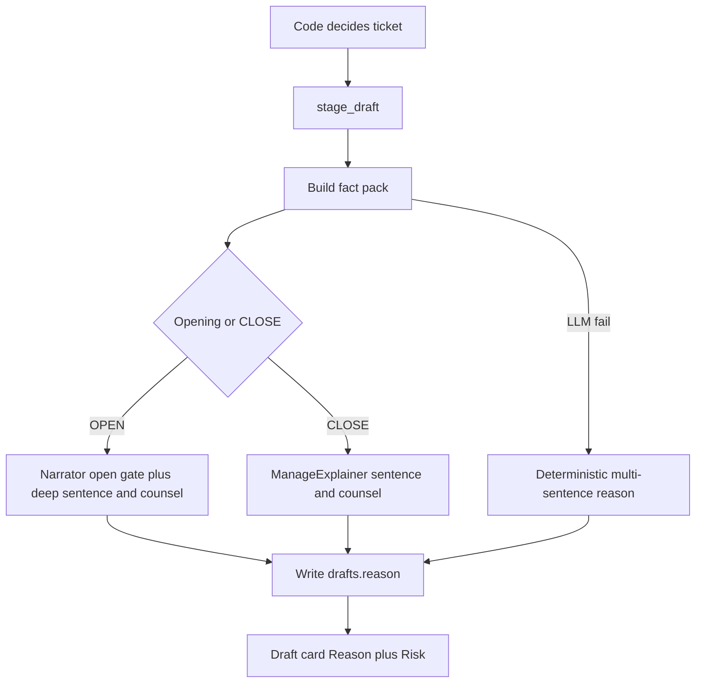

# 11 — Draft reasoning depth (explain + counsel)

**主计划**：[00-plan-order.md](00-plan-order.md) ｜ **规格对照**：[../athena/03-strategy-news-frontrun.md](../athena/03-strategy-news-frontrun.md)（Narrator / D11）
**状态**：**Implemented**（2026-10-15）。Not on the original signal critical path (steps 1–9). Side track after the wheel + Narrator land. Includes **D45** Telegram Approve-page URL regression.
**依赖**：步 6 Narrator open gate；`manage_book` CLOSE；D11（LLM 不得改 tactic / size / strike）；control link + tunnel env

> **性质**：提案与验收口径。确认后再动代码。提案先入 `docs/plan`，再实现。

---

## 0. Decisions (locked)

| ID | Decision | Ruling |
| --- | --- | --- |
| **D40** | LLM role on draft Reason | **Explain + counsel**. Deepen why the draft exists. May advise (e.g. assignment OK at this level / closing may be unnecessary) so a human can Reject. Must **not** change tactic, size, strike, or draft status. |
| **D41** | Scope | **All pending drafts**, not only CLOSE. Openings via deeper Narrator; CLOSE via ManageExplainer after stage. |
| **D42** | Fallback | Code builds a **fact pack**. On LLM / schema failure, write deterministic multi-sentence prose from that pack — never leave a one-liner when facts exist. |
| **D43** | Moneyness | Shared ATM / ITM / OTM helper (ATM = within 1% of strike). Badges on `/positions` option rows and on option draft cards. |
| **D44** | Assignment narrative | Spot / strike / DTE / right only. Do **not** reuse cycle-budget `bs_delta` / `assign_delta` for Reason text. |

Approve / Reject / Amend stay human. Code still decides the ticket.

---

## 1. Goals

| # | Goal | Pass when |
| --- | --- | --- |
| **G1** | Opening draft Reason has depth | Pending OPEN_* card Reason is multi-sentence (tags, price context, why this ticket), not only a code like `dip_long` or a single short line |
| **G2** | CLOSE draft Reason has depth | Pending CLOSE card Reason covers premium %, spot vs strike / moneyness, assignment outlook, and premium-vs-assignment tradeoff — not only `Premium captured N%.` |
| **G3** | Counsel is visible | When the model returns non-empty counsel, Reason shows a clear `Counsel:` block; human can Reject without the draft mutating |
| **G4** | Moneyness visible | Option rows on `/positions` and option drafts show ATM / ITM / OTM badges |
| **G5** | LLM outage safe | With LLM mocked to fail, CLOSE (and OPEN fallback path) still get multi-sentence fact-pack Reason |

---

## 2. Problem (current)

- **Openings**: Narrator returns `sentence` into `drafts.reason` (or falls back to ticket codes such as `dip_long`). The standing prompt does not require depth or counsel. Schema is `{"open":true,"sentence":"","strike":null}`.
- **CLOSE / MGMT**: `management_tactic` in `manage.py` only emits `Premium captured N%.`. No LLM call. Spot, strike, DTE, and assignment outcome are absent from Reason. Draft **Risk** stays `—` for CLOSE (opening cash badges only).
- **Positions**: put/call + side tags exist; no ATM / ITM / OTM.

---

## 3. Design

### 3.1 Fact pack (always code-built)

Shared helper used as LLM context and as fallback prose:

- Spot (`last_tradeable_price`), strike, right (`P` / `C`)
- Moneyness: ATM if `|spot − strike| / strike ≤ 1%`; else ITM / OTM from put/call rules
- DTE, premium captured % for shorts (avg vs mark), avg / mark
- Tags from `symbol_phases`
- Assignment sketch:
  - CSP put ITM → expiry assignment = long shares at strike; note effective cost vs remaining credit; closing locks captured premium
  - CC call ITM → shares called away at strike
  - ATM + DTE ≤ 2 → elevated pin / assignment risk
  - Clearly OTM → assignment unlikely
- Ticket / tactic code (`dip_long`, `manage_close`, …)

### 3.2 Openings — deeper Narrator (same call)

Keep open/quiet gate and optional listed-strike pick (D11).

- Schema: `{"open":true,"sentence":"","counsel":"","strike":null}` (`counsel` may be `""`)
- Prompt: `sentence` = 3–5 sentences (tags, price context, why this ticket vs quiet, moneyness/assignment when option); `counsel` = optional human guidance
- Persist with `format_draft_reason(sentence, counsel)` → `drafts.reason` (sentence, then blank line + `Counsel: …` when counsel non-empty)
- Empty sentence → fact-pack prose + opening reason code

### 3.3 CLOSE — ManageExplainer after stage

After a pending CLOSE draft is staged in `manage_book`:

1. Build fact pack for the symbol / leg
2. Call scoring model via existing `_ask` / `ai_calls` with agent **ManageExplainer** (no open gate; cannot invent legs)
3. Schema: `{"sentence":"","counsel":""}`
4. `UPDATE drafts SET reason = …` with the same formatter
5. On failure → fact-pack Reason

Seed ManageExplainer in `default_agents` / `resolved_agents` so Settings can edit it like Narrator.

### 3.4 Draft UI

- **Reason**: show full `drafts.reason`; use `white-space: pre-wrap` if needed
- **Risk** for option drafts (OPEN_* and CLOSE): code line with moneyness + assignment outlook; OPEN_* keeps cash badges
- Badge row: ATM / ITM / OTM when spot + strike exist (amber ITM, green OTM, teal ATM)

### 3.5 Positions

For `sec_type == OPT`, resolve spot (same-symbol STK mark in the load, else `last_tradeable_price`); badge after put/call.

---

## 4. Files (implementation map)

| Area | Path |
| --- | --- |
| Narrator / ManageExplainer prompts | `packages/settings/src/athena_settings/prompts.py` |
| Schemas | `packages/strategy-nfr/src/athena_strategy/schemas.py` |
| `_ask` / wheel Narrator wire | `packages/strategy-nfr/src/athena_strategy/agents.py` |
| Opening reason write | `packages/strategy-nfr/src/athena_strategy/wheel.py` |
| CLOSE + fact pack + explainer | `packages/strategy-nfr/src/athena_strategy/manage.py` (and/or small `draft_facts` helper) |
| Draft / positions UI | `apps/orchestrator/src/athena_orchestrator/pages.py` |
| Tests | `apps/orchestrator/tests/test_rules.py`, schema / wheel tests as needed |

No new migration expected (reason text only; optional Settings agent row is config, not schema).

---

## 5. Acceptance

- Narrator schema accepts `counsel`; rejects wrong types.
- ManageExplainer parse + `format_draft_reason` (sentence + `Counsel:`).
- Manage path with mocked LLM: Reason includes fact-pack fields; LLM failure still multi-sentence.
- Opening path: sentence + counsel land in `drafts.reason` when provided.
- Moneyness helper: 1% ATM band; put vs call ITM/OTM.
- Pending CLOSE card: Reason deeper than premium-only; Risk not `—` when spot/strike known.
- `/positions` option row shows ATM or ITM or OTM.

---

## 6. Out of scope

- LLM Approve / Reject or any draft field mutate other than `reason`
- Changing when CLOSE fires (`profit_take_pct` gate unchanged)
- ROLL drafting
- Using cycle-budget delta for the narrative
- LLM inventing strikes or legs on ManageExplainer

---

## 7. Relation to D11

D11: model explains or picks a **listed** strike; code decides legality and size. This booklet **extends explanation quality** and adds **advisory counsel**. It does not reopen nomination of off-menu strikes or veto of a legal ticket by the model. Human Reject remains the only soft veto after counsel.

---

## 8. Related regression — Telegram Approve page URL missing (D45)

**Symptom**: Telegram draft Approve/Reject messages no longer include the Approve-page URL / “Open approve page” button (details + web controls).

**How it is supposed to work**

- Live notify: `paper._notify_live_drafts` → `issue_link` → `control_page_url(token)` → `notify_draft` → `_draft_text` / `_markup` append URL only when non-empty ([`public_url.py`](../../apps/bots/src/athena_bots/public_url.py), [`telegram.py`](../../apps/bots/src/athena_bots/telegram.py)).
- URL base: `ATHENA_PUBLIC_BASE_URL` (set by cloudflared in [`tunnel.py`](../../apps/orchestrator/src/athena_orchestrator/tunnel.py)) or fallback `http://127.0.0.1:$ATHENA_CONTROL_PORT`. Both empty → **no URL in the message**.

**Likely causes (code + ops)**

| Cause | Effect |
| --- | --- |
| Tunnel off/failed and `ATHENA_CONTROL_PORT` unset | `control_page_url` returns `""` → text and button omitted |
| `_open_link` requires `ATHENA_CONTROL_PORT` even when public base is set | Bot-online re-announce / some paths drop the URL |
| `/drafts` (`draft_list_messages`) always passes `control_url=""` | List messages never show the Approve page |

**Ruling (D45)**

1. Every Telegram draft card that offers Approve/Reject must include the Approve-page URL when a live unused `control_links` token exists and a reachable base is configured.
2. Fix `_open_link` to use `control_page_url` without requiring `ATHENA_CONTROL_PORT` when `ATHENA_PUBLIC_BASE_URL` is set.
3. Fix `/drafts` to resolve the same URL (issue or reuse live token + `control_page_url`), not hardcode `""`.
4. Log a clear warning when `notify_draft` would send with an empty `control_url` (so tunnel/port misconfig is visible).
5. Add unit tests for `control_page_url` (public / localhost / empty) and for `_markup` / `_draft_text` / `draft_list_messages` including a non-empty URL when env + token exist.

**Acceptance**

- With `ATHENA_PUBLIC_BASE_URL=https://example.trycloudflare.com` and a live token, live notify and `/drafts` both show `Approve page …` and an `Open approve page` button.
- With only `ATHENA_CONTROL_PORT` set, URL uses localhost fallback (dev); warning if neither base is set.
- `_open_link` works with public base alone.
